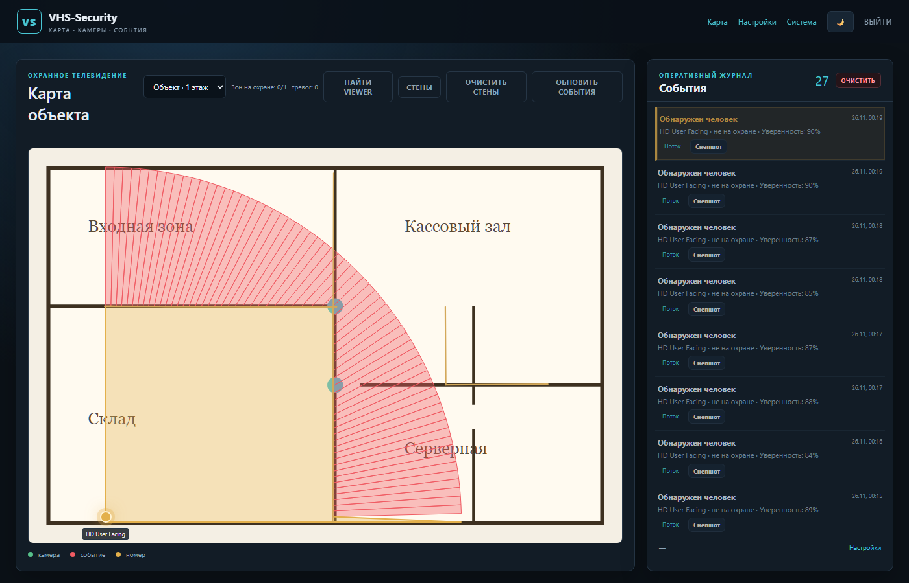
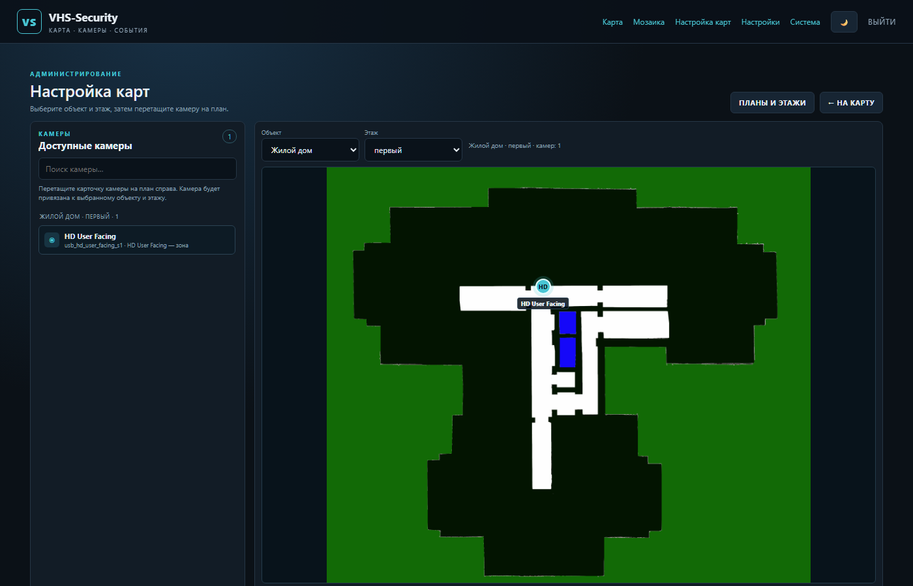
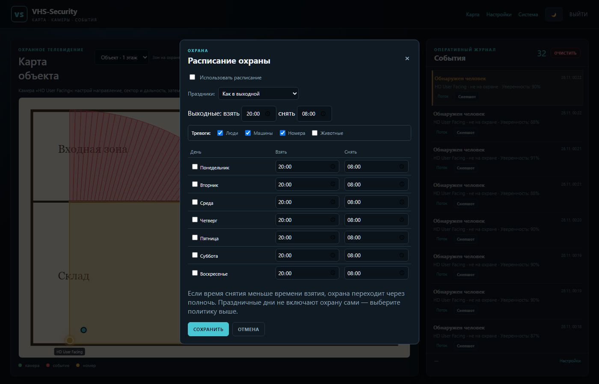
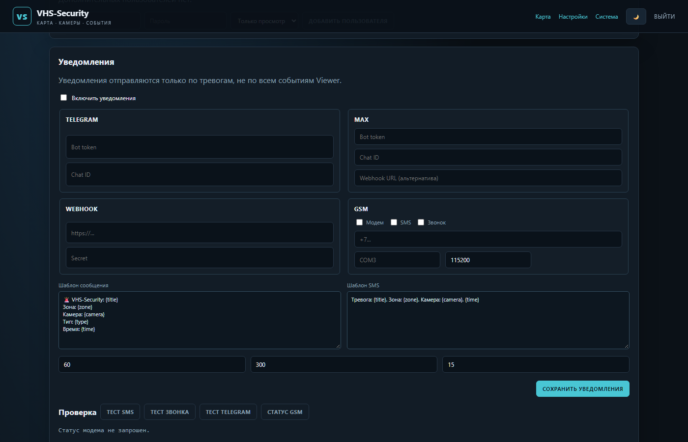
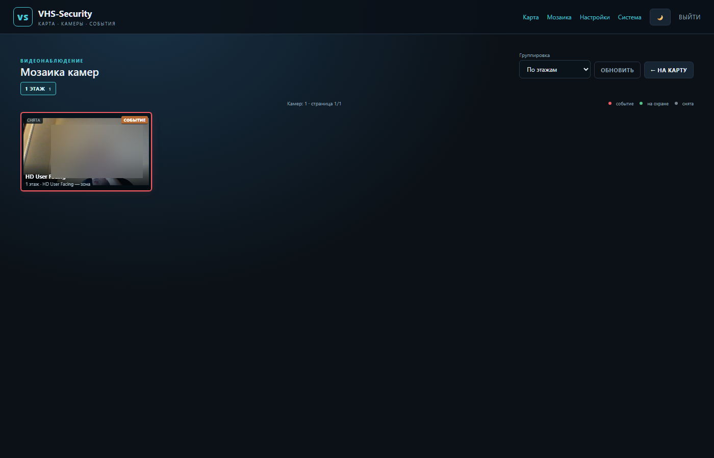

# VHS-Security

Охранный слой поверх **VHS-Streamer** и **VHS-Viewer**: карта объекта, мозаика камер, зоны охраны, расписания, тревоги и уведомления.

```text
VHS-Streamer  →  VHS-Viewer  →  VHS-Security
 камеры/потоки     аналитика      карта, зоны,
 MediaMTX          и шлюз          тревоги, GSM
```

**VHS-Security не обращается к Streamer напрямую.** Камеры, WebRTC-потоки и события Security получает из Viewer через `/api/integration/state`.

---

## Скриншоты

### Карта объекта



### Настройка карт



### Расписание зоны



### Уведомления и GSM



### Мозаика камер



---

## Карта

План этажа масштабируется без потери привязки камер и стен:

- колесо мыши — зум вокруг курсора;
- `+` / `−` — масштаб;
- `⤢` — сброс к 100%;
- `←` `↑` `↓` `→` — прокрутка плана в стороны и вверх/вниз;
- `Alt` + ЛКМ или средняя кнопка мыши — панорамирование;
- сектор камеры обрезается по стенам: зона за стеной не рисуется и не нагромождает карту;
- координаты камер и стен хранятся в процентах плана, поэтому не зависят от масштаба;
- клик по камере открывает модальное окно с видеопотоком;
- для камер с PTZ в этом окне доступны стрелки, зум, домой, стоп и
  инверсия осей;
- территория открывается на онлайн-карте, с границами и уличными камерами;
- редактирование камер, стен, зон и границ — в `/map-setup`.

---

## Три сервиса

| Сервис | Порт | Роль |
|---|---:|---|
| **VHS-Streamer** | `8100` | Камеры, RTSP/WebRTC, MediaMTX, запись, ONVIF/motion |
| **VHS-Viewer** | `8200` | Потребляет потоки Streamer, выполняет ALPR/YOLO-аналитику, отдаёт единое состояние в Security |
| **VHS-Security** | `8300` | Карта, зоны, расписания, праздники, Alarm engine, пользователи, уведомления |
| MediaMTX RTSP | `8554` | Потоки камер |
| MediaMTX WebRTC | `8889` | WHEP-сигнализация |
| MediaMTX API | `9997` | Управление потоками |

Порядок запуска:

1. **VHS-Streamer** — он поднимает MediaMTX и камеры.
2. **VHS-Viewer** — подключается к потокам Streamer.
3. **VHS-Security** — получает состояние из Viewer.

---

## Как устроена связка

### 1. Streamer → Viewer

Viewer берёт список камер и потоков из Streamer:

```text
GET http://127.0.0.1:8100/api/integration/streams
    X-VHS-Key: <security.api_token из config.yaml Streamer>
    X-VHS-Service: viewer
```

В ответ приходят `camera_id`, `camera_name`, RTSP/WebRTC-путь и свежий
авторизованный `webrtc_url`.

Ключ Streamer задаётся в `config.yaml` и указывается в `viewer_config.yaml`:

```yaml
# Streamer
security:
  api_token: <ключ интеграции>
```

```yaml
# Viewer
servers:
  - name: local
    url: http://127.0.0.1:8100
    api_key: <тот же ключ>
```

### 2. Viewer → Security

Security получает из Viewer камеры, WebRTC-потоки и события ALPR/YOLO:

```text
GET  http://127.0.0.1:8200/api/integration/state
GET  http://127.0.0.1:8200/api/integration/events
GET  http://127.0.0.1:8200/api/integration/ptz/capabilities
POST http://127.0.0.1:8200/api/integration/ptz/<camera_id>/<action>
     X-VHS-Key: <integration.ingest_key Viewer>
```

События Viewer пушатся в Security:

```text
POST http://127.0.0.1:8300/api/integrations/viewer/events
     X-VHS-Key: <integration.ingest_key Viewer>
```

Ключ Viewer задаётся один раз в `viewer_config.yaml` и в настройках Security:

```yaml
# Viewer
integration:
  ingest_key: <ключ Viewer для Security>
```

В Security тот же ключ сохраняется на странице **Настройки → Интеграция VHS**
в SQLite. Совместимые заголовки: `X-Ingest-Token`, `X-API-Token`.

### 3. Единый вход

Все три сервиса используют SSO-cookie `vhs_sso`, подписанную общим секретом.

```env
# VHS-Security
VHS_SSO_SECRET=CHANGE-ME
```

```yaml
# VHS-Viewer: viewer_config.yaml
security:
  sso_secret: CHANGE-ME
```

```yaml
# VHS-Streamer: config.yaml
security:
  sso_secret: CHANGE-ME
```

Секрет должен совпадать. Сессионные cookie при этом разные:

- `vhs_streamer_session`;
- `vhs_viewer_session`;
- `vhs_security_session`.

Вход в любой из трёх сервисов открывает остальные.

### 4. Видео

WHEP-сигнализация идёт через same-origin прокси:

```text
браузер → /api/whep своего сервиса → MediaMTX :8889
```

MediaMTX требует Basic Auth. Браузер не ходит в MediaMTX напрямую, поэтому логин-модалка и CORS-ошибки не появляются.

---

## Установка

Требования:

- Windows/Linux;
- Python 3.12;
- три проекта рядом:

```text
D:\Проекты\
  ├─ VHS-Streamer\
  ├─ VHS-Viewer\
  └─ VHS-Security\
```

Для каждого проекта:

```powershell
python -m venv .venv
.\.venv\Scripts\pip install -r requirements.txt
```

### Запуск

```powershell
# 1. Streamer
cd D:\Проекты\VHS-Streamer
.\run.bat

# 2. Viewer
cd D:\Проекты\VHS-Viewer
.\start.bat

# 3. Security
cd D:\Проекты\VHS-Security
.\run.bat
```

Открыть:

- Streamer — `http://127.0.0.1:8100/`
- Viewer — `http://127.0.0.1:8200/`
- Security — `http://127.0.0.1:8300/`

Локальные учётные данные по умолчанию: `admin / admin`. **Поменяйте их перед публикацией в сеть.**

---

## Настройка Security

Создайте `.env`:

```powershell
Copy-Item .env.example .env
notepad .env
```

Минимальный `.env`:

```env
SECRET_KEY=<длинная случайная строка>
VHS_SECURITY_USER=admin
VHS_SECURITY_PASSWORD=<пароль администратора>
VHS_SECURITY_DATA=./data

VIEWER_URL=http://127.0.0.1:8200
VHS_SECURITY_INGEST_TOKEN=<integration.ingest_key Viewer>
VHS_SSO_SECRET=<общий SSO-секрет>
```

Проверьте в Viewer:

```env
VHS_STREAMER_URL=http://127.0.0.1:8100
VHS_STREAMER_API_TOKEN=<security.api_token Streamer>
VHS_SECURITY_EVENTS_URL=http://127.0.0.1:8300/api/integrations/viewer/events
VHS_SECURITY_INGEST_TOKEN=<тот же integration.ingest_key>
```

SSO-секрет должен совпадать во всех модулях:

```yaml
security:
  sso_secret: <общий SSO-секрет>
```

---

## Первый запуск

1. Откройте Security.
2. Войдите как администратор.
3. Откройте **Настройки**.
4. Проверьте Viewer URL или нажмите **«Найти Viewer»** на карте.
5. Создайте здание и этаж.
6. Загрузите план этажа: PNG, JPG, JPEG, WEBP или SVG.
7. Нажмите **«Обновить события»** — камеры импортируются из Viewer.
8. Создайте **зону охраны** и привяжите к ней камеры.
9. Настройте расписание зоны:
   - будни;
   - выходные;
   - праздники.
10. Выберите типы тревог камеры:
    - человек;
    - машина;
    - номер;
    - животное.
11. При необходимости настройте Telegram/MAX/webhook и GSM.

---

## Настройка карт

Доступна только администратору: вкладка **«Настройка карт»**.

- слева — доступные камеры;
- справа — план выбранного объекта и этажа;
- выбрать объект и этаж;
- перетащить камеру из левой панели на план;
- камера привязывается к этому этажу и получает координаты точки сброса;
- уже установленную камеру можно перетащить по плану.

Так камеры сначала распределяются по объектам, затем по этажам, затем по фактическим местам на плане.

Кнопка **«Найти Viewer»** с карты убрана.

---

## Мозаика камер

Вкладка **«Мозаика»** показывает потоки всех камер плитками.

- страница не прокручивается: мозаика занимает один экран;
- сначала группировка по объектам;
- детализация выбранного объекта по этажам или по охране: на охране / сняты / без зоны;
- объекты, этажи и страницы камер переключаются внутренними вкладками;
- количество плиток рассчитывается по размеру окна;
- рамка камеры подсвечивается красным, если по камере есть свежее событие в журнале или активная тревога;
- обновление состояния каждые 5 секунд;
- видео подключается по WHEP через `/api/whep` Security.

---

## Зоны и охрана

Единица охраны — **зона**, а не камера.

```text
Объект → Этаж → Зона охраны → камеры
```

У зоны есть:

- ручное состояние «на охране / снято»;
- расписание по дням недели;
- ночной переход через полночь;
- отдельное расписание выходных;
- политика на праздники:
  - как в обычный день;
  - как в выходной;
  - по отдельному расписанию;
  - не брать на охрану.

Праздник сам по себе **не включает охрану**. Он только выбирает, какое расписание применить.

Эффективное состояние зоны вычисляется на момент события, поэтому Alarm engine не зависит от фонового таймера.

---

## Тревоги

Alarm engine создаёт тревогу, если:

1. пришло событие Viewer;
2. камера привязана к зоне;
3. зона на охране в момент события;
4. тип события включён в настройках камеры.

Иначе событие остаётся в журнале как информационное.

Тревоги видны:

- в журнале с меткой **ТРЕВОГА**;
- на карте — красным маркером камеры;
- в счётчике «Зон на охране / тревог».

---

## Уведомления

Уведомления отправляются **только по тревогам**, не по всем событиям Viewer.

Поддерживаются:

- Telegram Bot API;
- MAX Bot API или webhook;
- произвольный webhook;
- SMS через GSM-модем;
- голосовой звонок через GSM-модем.

Очередь хранится в SQLite:

- до 5 повторных попыток;
- увеличивающаяся пауза;
- журнал отправок;
- ошибки не роняют Security.

Голосовой звонок создаётся только после успешной доставки в мессенджер/SMS и ограничен по частоте.

### GSM

Для SMS/звонков используется `pyserial` и AT-команды.

Настройки в Security:

- COM-порт;
- скорость;
- номер телефона;
- включение модема/SMS/звонков;
- шаблон сообщения;
- шаблон SMS;
- задержка звонка;
- пауза между звонками;
- длительность звонка.

Кнопка **«Статус GSM»** показывает SIM, сигнал и регистрацию в сети.

Проверка без модема возвращает ошибку в журнал, но не останавливает сервис.

---

## Праздники

В настройках можно:

- добавить праздник вручную;
- удалить;
- нажать **«Взять из интернета»** и выбрать год.

Импорт:

- основной источник — Nager.Date (с названиями);
- резервный — isdayoff.ru;
- существующие записи не перезаписываются.

---

## Территории, объекты и этажи

Иерархия в базе:

```text
Территория (координаты)
  └── Объект (здание/сооружение, координаты)
        └── Этаж (план, стены, зоны)
              └── Камеры
```

Территория — верхний уровень. Внутри неё создаются объекты, у объектов —
этажи с планами. Для территории используется онлайн-карта, а не картинка
плана:

- уличные камеры перетаскиваются на карту;
- сохраняются широта и долгота;
- задаётся азимут, угол сектора и дальность в метрах;
- граница территории рисуется по точкам;
- клик по камере на карте открывает видео и PTZ.

Гео-слой работает на Leaflet. Провайдер подложки выбирается в `.env`:

```env
GEO_MAP_PROVIDER=leaflet
# или
GEO_MAP_PROVIDER=yandex
YANDEX_MAPS_API_KEY=ваш-ключ
```

Для Яндекса нужен действующий API-ключ. Без ключа автоматически используется OpenStreetMap.

---

## Объекты

В настройках раздел **«Объекты на территории»** позволяет:

- переименовать объект;
- изменить адрес и координаты;
- выбрать территорию;
- удалить ошибочно созданный дубль.

Удаление объекта каскадно удаляет его этажи, зоны, камеры и события. Последнюю территорию удалить нельзя — сначала создайте новую.

---

## PTZ

PTZ доступен для IP-камер с ONVIF. Управление идёт по цепочке:

```text
Security → Viewer → Streamer → ONVIF
```

В Security панель есть в мозаике, полноэкранном режиме и в модальном окне
камеры на карте. Для камер без PTZ панель не показывается.

Поддерживаются движение, зум, домой, стоп и инверсия осей. Инверсия хранится
в конфиге камеры Streamer и действует одинаково во всех клиентах.

---

## Пользователи

Роли:

- **Администратор** — настройки, зоны, камеры, расписания, пользователи;
- **Только просмотр** — карта, камеры, потоки, события и снепшоты.

Просмотр не может:

- открыть настройки;
- двигать/поворачивать камеры;
- менять стены;
- очищать журнал;
- запускать синхронизацию;
- менять зоны и расписания.

Встроенный администратор задаётся в `.env`. Дополнительные пользователи — в `/settings`.

---

## API Security

| Метод | Путь | Назначение |
|---|---|---|
| GET | `/api/state?floor_id=` | этаж, камеры, зоны, события, тревоги |
| GET | `/api/mosaic` | камеры всех этажей для мозаики и состояние охраны |
| GET | `/api/map-setup` | объекты, этажи и камеры для панели настройки |
| POST | `/api/cameras/<id>/place` | привязка камеры к этажу и координатам |
| POST | `/api/cameras/<id>/place-geo` | привязка уличной камеры к территории |
| POST | `/api/cameras/<id>/geo-view` | азимут, сектор и дальность уличной камеры |
| GET | `/api/ptz/capabilities` | PTZ-возможности и инверсия |
| POST | `/api/ptz/<camera_id>/<action>` | PTZ через Viewer: move/stop/home/invert |
| GET | `/api/events?floor_id=` | журнал событий |
| GET | `/api/alarms?status=active` | тревоги |
| POST | `/api/sync` | синхронизация из Viewer |
| POST | `/api/zones/<id>/arm` | взять/снять зону с охраны |
| GET/POST | `/api/zones/<id>/schedule` | расписание зоны |
| POST | `/api/cameras/<id>/position` | координаты/угол/FOV камеры |
| POST | `/api/cameras/<id>/schedule` | типы тревог камеры |
| GET | `/api/holidays` | список праздников |
| GET | `/api/gsm/status` | статус GSM-модема |
| POST | `/api/whep` | same-origin прокси WHEP |
| POST | `/api/integrations/viewer/events` | приём событий Viewer по токену |

---

## Структура проекта

```text
VHS-Security/
  app.py                 Flask-приложение, карта, зоны, Alarm engine
  notifications.py       Очередь, Telegram/MAX/webhook, GSM
  vhs_sso.py             Общая SSO-cookie
  templates/             HTML-шаблоны
  static/                CSS/JS
  tests/                 unittest
  data/
    plans/               Планы этажей
    vhs_security.db      SQLite (не коммитится)
  .env.example           Пример конфигурации
  requirements.txt
```

---

## Сборка exe

Иконка приложения и favicon используют `icon.ico`.

```powershell
.\build_exe.bat
```

Результат:

```text
dist\VHS-Security.exe
```

Параметры сборки находятся в `VHS-Security.spec`: иконка `icon.ico`, шаблоны и статика включаются в exe. База, планы и `.env` создаются рядом с exe.

Favicon доступен по `/favicon.ico` и подключён на всех страницах.

---

## Тесты

```powershell
cd D:\Проекты\VHS-Security
.\.venv\Scripts\python.exe -m unittest tests.test_app -v
```

---

## Диагностика

| Проблема | Что проверить |
|---|---|
| Security не видит камеры | `VIEWER_URL`, доступность Viewer, `VHS_SECURITY_INGEST_TOKEN` |
| Дубли камер | нажать «Обновить события»; Viewer должен отдавать один `camera_id` |
| Вход зацикливается | одинаковый `vhs_sso_secret` во всех трёх сервисах |
| Чёрное видео | MediaMTX `8554/8889`, Basic Auth, `/api/whep` |
| Нет тревог | зона на охране, тип тревоги включён у камеры |
| Нет SMS | COM-порт, SIM, `AT+CPIN?`, баланс |
| Нет уведомлений | включены уведомления и нужный канал |
| Праздник не влияет | политика зоны и дата в списке праздников |

---

## Безопасность

- `.env`, `data/*.db`, планы и логи исключены из Git.
- Не публикуйте `SECRET_KEY`, `VHS_SSO_SECRET`, `VHS_SECURITY_INGEST_TOKEN` и токены ботов.
- Перед выходом в сеть смените `admin/admin`.
- Для внешнего доступа используйте HTTPS-обратный прокси.

---

## Статус

Проект развивается как локальный охранный слой. Перед публикацией во внешнюю сеть обязательно настройте HTTPS, смените пароли и проверьте права пользователей.
